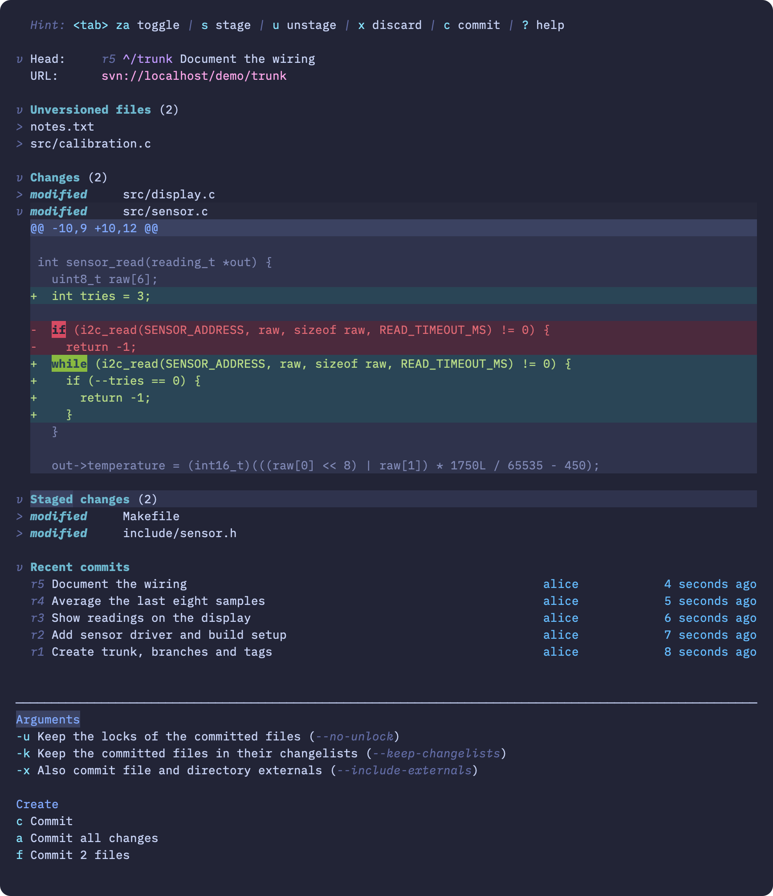

# sven.nvim

Subversion in Neovim, with the look and feel of [Neogit](https://github.com/NeogitOrg/neogit).



Still on svn at work, but your fingers know Neogit? Open `:Sven`, and the keys you already use do what you expect: `s` to stage, `c c` to commit, `l l` for the log, `?` when in doubt.

## What you get

- **A status buffer** with your conflicts, unversioned files, changes and recent commits. Unfold any file to see its diff, hunk by hunk.
- **Staging, for svn.** `s` and `u` pick what goes into the next commit. `x` discards a file, a single hunk, or just the lines you selected.
- **Commit, update and resolve** from popups, with a proper commit message editor.
- **History**: a log view, a revision view with message, changed paths and diff, and a blame gutter next to your file.
- **Diffs** inline in the file you are editing, if you have [unified.nvim](https://github.com/papricasix/unified.nvim).
- **Your colorscheme.** If it supports Neogit, it supports sven.

## Install

With [lazy.nvim](https://github.com/folke/lazy.nvim):

```lua
{
  "papricasix/sven.nvim",
  cmd = "Sven",
  keys = {
    { "<leader>sg", function() require("sven").open() end, desc = "Svn: Open Sven" },
  },
  opts = {},
}
```

You need Neovim 0.10 or newer and Subversion 1.9 or newer, with credentials for your repositories cached: sven never prompts.

## Good to know

Subversion has no staging area, so sven borrows a changelist (`sven-staged`) for it. That keeps staging real svn state you can see in `svn status`, and it means staging works per file, not per hunk.

This is a first version. Branching, switching and merging are not there yet, and it has been tested against local repositories only.

The [guide](docs/guide.md) has every key, the popups in detail, how staging behaves at the edges, and how to run the tests.

## Credits

sven's UI core is derived from [Neogit](https://github.com/NeogitOrg/neogit) by TimUntersberger, CKolkey and contributors, used under the MIT license. Neogit's copyright notice is retained in [LICENSE](LICENSE).
